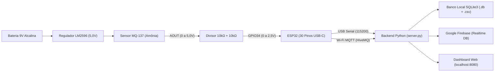
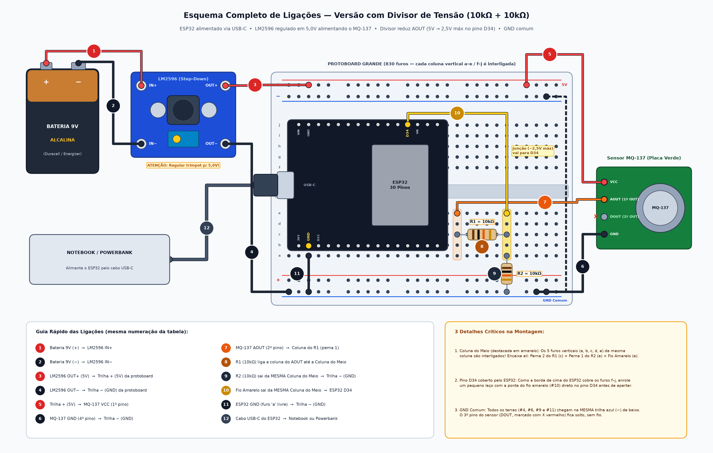

# Sistema IoT de Monitoramento de Odor e Amônia (MQ-137 + ESP32 + SQLite + Firebase)

Projeto completo de Internet das Coisas (IoT) para monitoramento contínuo da qualidade do ar e concentração de amônia ($\text{NH}_3$) em ambientes sanitários, integrando **eletrônica embarcada com proteção por divisor de tensão**, **firmware ESP32 não-bloqueante (USB + Wi-Fi MQTT)**, **backend Python com dupla persistência (SQLite3 local + Google Firebase Realtime Database / Firestore)**, **Dashboard Web interativa** e **Case 3D paramétrica pronta para impressão**.

---

## Visão Geral da Arquitetura



---

## Estrutura do Repositório

| Pasta / Arquivo | Descrição |
| :--- | :--- |
| [`dashboard/`](./dashboard) | Servidor Python (`server.py`), Painel Web (`index.html`), inspetor de banco em tempo real e iniciador automático (`Iniciar_Dashboard.bat`). |
| [`firmware/sensor_odor_divisor_5v/`](./firmware/sensor_odor_divisor_5v) | Firmware C++ para Arduino IDE / ESP32 com leitura filtrada de 20 amostras, cálculo do divisor 5V → 2,5V e envio simultâneo via USB Serial e MQTT. |
| [`hardware/`](./hardware) | Diagrama técnico completo das 12 ligações na protoboard de 830 furos (`esquema_divisor_tensao.png`) e script gerador em Matplotlib. |
| [`case_3d/`](./case_3d) | Arquivos prontos para impressão 3D (`Case Sensor Odor - Base.stl` e `Case Sensor Odor - Tampa.stl`), modelagem CSG em Python (`gerar_case.py`) e renders 3D. |

---

## Esquema Elétrico (Versão com Divisor de Tensão 10kΩ + 10kΩ)

O sensor **MQ-137** opera com aquecedor interno em **5,0 V** (fornecidos pelo conversor step-down **LM2596** a partir de uma bateria alcalina de 9 V). Como as portas analógicas do **ESP32** suportam no máximo **3,3 V**, utilizamos um divisor resistivo com dois resistores de **10 kΩ** ($R_1 = 10\,\text{k}\Omega$ e $R_2 = 10\,\text{k}\Omega$):

$$V_{\text{GPIO34}} = V_{\text{AOUT}} \times \frac{R_2}{R_1 + R_2} = V_{\text{AOUT}} \times 0{,}5 \quad (\text{máx. } 2{,}50\text{ V no pino D34})$$



### Lista Rápida dos 12 Fios
1. **Bateria 9V (+)** $\rightarrow$ `IN+` do LM2596
2. **Bateria 9V (-)** $\rightarrow$ `IN-` do LM2596
3. **`OUT+` do LM2596 (ajustado em 5,0V)** $\rightarrow$ Trilha vermelha `+` da protoboard
4. **`OUT-` do LM2596** $\rightarrow$ Trilha azul `-` (GND comum) da protoboard
5. **Trilha `+` (5,0V)** $\rightarrow$ Pino `VCC` do módulo MQ-137
6. **Trilha `-` (GND)** $\rightarrow$ Pino `GND` do módulo MQ-137
7. **Pino `AOUT` do MQ-137** $\rightarrow$ Coluna de entrada do resistor `R1 (10kΩ)`
8. **Resistor `R1 (10kΩ)`** $\rightarrow$ Da coluna de `AOUT` até a **Coluna Central do Divisor**
9. **Resistor `R2 (10kΩ)`** $\rightarrow$ Da **Coluna Central do Divisor** até a trilha azul `-` (GND)
10. **Fio de Sinal (`GPIO34`)** $\rightarrow$ Da **Coluna Central do Divisor** até o pino `D34` do ESP32
11. **Pino `GND` do ESP32** $\rightarrow$ Trilha azul `-` da protoboard (**terra comum obrigatório**)
12. **Cabo USB-C do ESP32** $\rightarrow$ Computador (alimentação lógica do ESP32 + telemetria Serial)

---

## Case 3D para Impressão (Protoboard 830 Furos + Bateria 9V + LM2596 + MQ-137)

A caixa protetora (`174,8 × 96,8 × 42,4 mm` na base + tampa de encaixe com grelha colmeia sobre o sensor MQ-137 e janela lateral USB-C) está disponível na pasta [`case_3d/`](./case_3d):

| Case Montada | Disposição Interna dos Componentes |
| :---: | :---: |
|  |  |

---

## Como Executar o Projeto

### 1. Instalar dependências Python (em ambiente virtual `.venv`)
```powershell
python -m venv .venv
.\.venv\Scripts\pip install -r requirements.txt
```

### 2. Gravar o Firmware no ESP32
1. Abra [`firmware/sensor_odor_divisor_5v/sensor_odor_divisor_5v.ino`](./firmware/sensor_odor_divisor_5v/sensor_odor_divisor_5v.ino) na **Arduino IDE**.
2. Instale pelas bibliotecas da IDE: **`PubSubClient`** e **`ArduinoJson`**.
3. Selecione a placa **ESP32 Dev Module** e envie para a porta COM do seu ESP32. *(Você também pode configurar o nome e a senha do Wi-Fi 2.4 GHz direto pela tela da Dashboard via USB, sem precisar regravar o código).*

### 3. Iniciar o Servidor Python + Dashboard Web
```powershell
.\.venv\Scripts\python.exe dashboard\server.py
```
Ou dê dois cliques em [`dashboard/Iniciar_Dashboard.bat`](./dashboard/Iniciar_Dashboard.bat) e acesse **`http://localhost:8080`**.

### 4. Vincular ao Google Firebase (Opcional — Nuvem em Tempo Real)
1. No [Console do Firebase](https://console.firebase.google.com/), crie um **Realtime Database** (em modo de teste durante o desenvolvimento).
2. Na Dashboard (`http://localhost:8080`), clique em **Conectar Firebase**, cole a URL `https://seu-projeto-default-rtdb.firebaseio.com` e clique em **Testar Conexão & Ativar Upload Automático**.
3. Todas as leituras gravadas no banco local `SQLite3` (`sensor_odor.db`) passam a subir automaticamente para a nuvem com números visíveis direto na raiz (`01_intensidade_odor_pct`, `02_tensao_sensor_aout_V`, `03_tensao_pino_d34_V`, `04_leitura_adc_bruto`).
